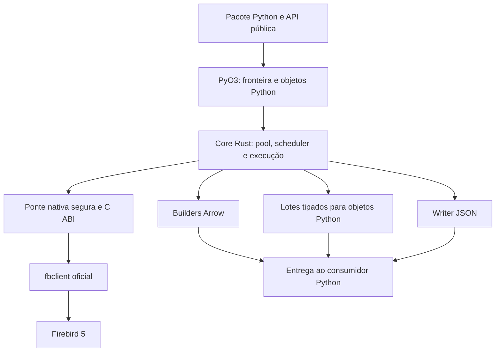

# fbfast — plano final de implementação

Data: 14/10/2026. Estado: especificação para implementação; não representa código pronto, homologação ou desempenho já medido.

Este é o documento único de trabalho dos agentes que implementarão a biblioteca. Consolida `read.md`, `plano_fbfast_claude.md` e `plano_fbfast_codex.md`, resolvendo divergências e incorporando as prioridades do autor: **desempenho, código organizado e distribuição versionada simples**. Os três documentos de origem permanecem como histórico; suas alternativas não são requisitos concorrentes.

**Atualização de distribuição em 15/10/2026:** por orientação do autor, repositório público e instalação por `uv`/`pip` passam a ser o caminho principal. Preferir wheels prontos para consumidores; instalação direta do Git compila os fontes e requer toolchain/SDK. A pasta `dist/vendor/fbfast/` permanece como extração do mesmo wheel para uso alternativo e teste de relocação. Esta atualização prevalece sobre trechos abaixo que descrevem uv/pip como secundários; os requisitos funcionais P0–P6 permanecem integrais. Detalhes e evidências em `docs/decisions/0004-distribution-uv.md`. Nenhuma publicação remota automática está autorizada por este plano.

**Atualização de limites em 15/10/2026:** por orientação do autor, `max_result_bytes` foi removido. O resultado completo tem apenas limite opcional de linhas; limites por lote, BLOB e cache permanecem. A seção 6.3 incorpora essa alteração; detalhes em `docs/decisions/0009-config-ergonomics.md`.

**Revisão de escopo pelo autor em 15/10/2026 (prevalece sobre P0–P6 abaixo):** o autor informou que a biblioteca já oferece as funcionalidades de leitura de que precisa e pediu foco em distribuição: workflow GitHub Actions para builds por SO e integração de publicação na sua conta PyPI. A entrega ativa passa a ser empacotar, testar e automatizar a publicação da API atual, mantendo o núcleo Rust e a prioridade de desempenho. Extração paralela P5, novas APIs/métricas e a matriz extensa de benchmarks ficam como backlog, não como bloqueadores desta entrega. Sync/async já implementados permanecem; não foi solicitada a remoção de funcionalidades. Publicação deve ser acionada por release/tag do autor, após configurar o Trusted Publisher; esta revisão não autoriza commit/push ou publicar automaticamente o worktree ainda não commitado. Detalhes em `docs/decisions/0018-release-scope.md`.

## 1. Goal e resultado esperado

Construir `fbfast`, uma biblioteca Python de leitura para Firebird 5, com núcleo Rust, pool nativa, APIs síncrona/assíncrona e saídas eficientes em tuplas, Arrow/Polars e JSON.

O primeiro resultado utilizável deve permitir este fluxo:

1. Desenvolver e compilar neste repositório.
2. Gerar um wheel contendo pacote Python, extensão compilada e runtime Firebird necessário.
3. Instalar o wheel no projeto consumidor com `uv add` (ou uv pip/pip).
4. Executar `import fbfast` e consultar o banco sem Rust/C++ no consumidor e sem depender de PyPI para obter a biblioteca. A instalação direta do Git é alternativa que compila os fontes; a cópia de `dist/vendor/fbfast/` também continua disponível.
5. Recompilar aqui e substituir a pasta para experimentar novas versões.

O projeto consumidor ainda precisa de um Python compatível e, se usar DataFrames, do extra correspondente, como Polars. Copiar a pasta não instala esses extras.

A conclusão do goal inicial é **uma versão local testável e demonstrada**, incluindo os caminhos rápidos e a extração paralela restrita especificada neste plano. Publicar no PyPI, implementar protocolo próprio e homologar todas as plataformas são evoluções separadas; não são condições para o autor começar a usar a biblioteca.

### Prioridades, em ordem

1. Correção dos dados, precisão e liberação segura dos recursos.
2. Desempenho comprovado no formato final que a aplicação consome.
3. Estrutura pequena por responsabilidade, dependências claras e ausência de duplicação.
4. Uso local simples, diagnóstico útil e API estável entre pasta copiada e instalação futura.
5. Ampliar plataformas e funcionalidades apenas com evidência e necessidade.

Não considerar uma etapa pronta só porque compila. Cada entrega tem critérios de aceite na seção 19. Falta de ambiente, recurso ainda experimental e teste não executado devem aparecer como pendências explícitas.

## 2. Decisões consolidadas

| Tema | Decisão final | O que foi aproveitado ou corrigido |
| --- | --- | --- |
| Experiência Python | `FirebirdConfig`, `Pool`, funções de módulo e pools nomeadas | Simplicidade do `read.md` |
| Motor | Rust para pool, execução, decodificação e buffers | Convergência dos três documentos |
| Backend inicial | `fbclient` oficial, por ponte C ABI pequena para sua API OO | Cobertura moderna do plano Codex, submetida a avaliação de desempenho |
| Protocolo Rust próprio | Experimento condicionado a gargalo comprovado; sem segundo backend no início | Preserva a ambição técnica do plano Claude sem assumir ganhos não medidos |
| Transações | Curta por operação; snapshot explícito para várias leituras | Corrige a proposta de transação permanente com READ CONSISTENCY |
| Escrita | Fora da primeira linha de versões; `read_only=False` rejeitado | Resolve a contradição entre “somente leitura” e DML RETURNING do plano Claude |
| Limpeza da sessão | Reset ao devolver um empréstimo; custo e compatibilidade medidos desde o protótipo | Isolamento entre consumidores do plano Codex |
| Cache | Statements por attachment, com limites e validação após reset | Localidade e menor custo de prepare dos dois planos |
| Resultado | Destinos especializados: linhas, Arrow e JSON | Caminho direto proposto pelos dois planos |
| Arrow | Buffers colunares em Rust e transferência via PyCapsule | Sem lista intermediária de tuplas Python |
| Async | Workers nativos limitados, sem bloquear o event loop | Descreve honestamente o backend bloqueante inicial |
| Streaming | Context managers, limites por bytes/linhas e backpressure | Evita retenção ilimitada e conexão abandonada |
| Paralelismo | Opt-in, subconjunto de consultas e snapshot compartilhado | Ganho potencial do Claude e requisitos de correção do Codex |
| Retry | Sem repetir automaticamente SQL já enviada | Leitura não implica ausência de efeitos ou resultado estável |
| Tipos | Exatos por padrão, sem cast silencioso, trim ou renomeação automática | Preserva os dados antes de perseguir números de benchmark |
| Distribuição inicial | Pasta compilada relocável, pronta para copiar | Última orientação do autor; substitui instalação editable como fluxo principal |
| PyPI | Preparar o empacotamento; publicar apenas numa etapa futura solicitada | Não vincular o uso local a publicação |

### Correções técnicas que não podem reaparecer na implementação

- **Não manter READ CONSISTENCY READ ONLY indefinidamente com a alegação de que não afeta GC.** A documentação do Firebird diferencia essa modalidade de READ COMMITTED READ ONLY tradicional: a primeira atrasa o avanço de OST, afetando o GC tradicional. A escolha deste plano é encerrar transações entre operações independentes. [Fonte oficial, revisão 5.0.4](https://raw.githubusercontent.com/FirebirdSQL/firebird/v5.0.4/doc/README.read_consistency.md).
- Não prometer uma consulta inteira em um RTT usando apenas cache. Preparação, transação, fetch, BLOBs e limpeza entram na medição. O protocolo pode responder um lote menor que o solicitado sem indicar EOF. [Protocolo oficial](https://firebirdsql.org/file/documentation/html/en/firebirddocs/wireprotocol/firebird-wire-protocol.html).
- `fetch_size` limita lotes da biblioteca; não significa “linhas por round-trip”.
- Zero-copy se aplica, quando possível, à entrega dos buffers Arrow já construídos. Recepção, decodificação e organização colunar continuam existindo.
- Não comparar `fbfast` com um baseline que reconecta e prepara tudo quando existe reutilização equivalente. Não atribuir ao Rust ganhos que vieram apenas de atualizar o cliente Firebird.
- Não apresentar `READ ONLY` como sandbox para SQL hostil, nem aceitar procedures executáveis como extensão implícita do escopo.

## 3. Arquitetura e organização obrigatória



### 3.1 Limites entre camadas

| Camada | Responsabilidade | Não deve conhecer |
| --- | --- | --- |
| `fbfast-native` | Carregamento do cliente, ponte C++, handles, status, wrappers Rust seguros | Python, pool global, FastAPI, Polars |
| `fbfast-core` | Configuração validada, pool, transações, execução, tipos, destinos e partições | PyO3, objetos Python, rotas e aplicação consumidora |
| `fbfast-python` | Binding, conversão de parâmetros/objetos, awaitables e registro de pools | Detalhes de vtables C++ ou políticas de rede duplicadas |
| `python/fbfast` | Reexports, adaptadores finos de consumidores e tipagem | Loop Python de fetch/decodificação por célula |

Dependências seguem `python → core → native`; não pode haver ciclo. Os destinos de resultado ficam no core, separados da política da pool. Um plano de decodificação atende destinos especializados, sem impor Arrow às consultas pequenas.

Começar com três crates. Não criar framework de plugins, interfaces para cada struct ou vários runtimes “para o futuro”. A API interna do cliente deve ser pequena e permitir substituição localizada; abstração polimórfica só entra quando houver uma segunda implementação real ou necessidade de teste justificada.

### 3.2 Estrutura de referência

Criar módulos conforme a funcionalidade nasce; não gerar uma árvore de arquivos vazios.

```text
firebird_rust/
  plano_fbfast_final.md
  Cargo.toml
  Cargo.lock
  rust-toolchain.toml
  pyproject.toml
  crates/
    fbfast-native/
      build.rs
      bridge/                 # C ABI estreita; separação por recurso
      src/
        lib.rs
        loader.rs
        status.rs
        attachment.rs
        transaction.rs
        statement.rs
        cursor.rs
        blob.rs
        metadata.rs
    fbfast-core/src/
      lib.rs
      config/                 # resolução, defaults e validação
      pool/                   # slots, leases, fila, manutenção e métricas
      execution/              # consulta, deadlines, cancelamento, cleanup
      statements/             # cache e validação de SQL
      decode/                 # schema, planos e famílias de tipos
      sinks/                  # rows, Arrow e JSON
      streaming/
      partition/
      error.rs
    fbfast-python/src/
      lib.rs
      config.rs
      pool.rs
      registry.rs
      asyncio.rs
      conversion/             # conversão de fronteira por família
      errors.rs
  python/fbfast/
    __init__.py
    _adapters.py
    _native.pyi
    py.typed
  scripts/
    build_vendor.py
    verify_vendor.py
  tests/
    unit/
    integration/
    packaging/
  benchmarks/
    fixtures/
    adapters/
    scenarios/
    results/
  examples/
  docs/
    decisions/
  dist/                       # gerado; fora do controle de versão
```

### 3.3 Regras verificáveis contra código bagunçado

- Um módulo deve ter uma responsabilidade nomeável; não concentrar pool, tipos, SQL e binding em `pool.rs` ou `lib.rs`.
- Alvo de **até 350 linhas de produção por arquivo**. Acima disso, revisar coesão antes de continuar. **Acima de 500 linhas exige divisão ou exceção técnica registrada**, com motivo verificável. Código gerado e fixtures são separados e identificados.
- Funções com mais de aproximadamente 60 linhas exigem revisão de responsabilidade. Laços de decodificação coesos podem justificar exceção; não fragmentar o caminho quente em dezenas de wrappers só para satisfazer contagem.
- `lib.rs` e `__init__.py` fazem composição/reexports, não implementam regras. Evitar módulos genéricos `utils`, `helpers`, `common` como depósito.
- Validação e defaults têm uma única implementação Rust. Fachada, API sync, API async e funções de módulo reutilizam o mesmo pipeline de execução e cleanup.
- `unsafe` nativo fica na fronteira e tem comentário de invariantes. O core deve proibir `unsafe`. Qualquer uso de C API Python fica isolado no binding e precisa justificar ganho e ownership.
- Nenhum `unwrap`/`expect` em caminhos que dependem de SQL, configuração, rede ou dados externos. Sem capturar erro e devolver lista vazia.
- Sem singletons ocultos para conexões; registro global é uma fachada explícita. Sem dependências de ERP, aplicação consumidora ou diretórios absolutos do desenvolvedor.
- Não implementar primitivas criptográficas, allocators, filas lock-free ou serializadores de escape artesanalmente sem necessidade demonstrada. Preferir componentes consolidados, com conjunto mínimo de features.
- Testes verificam comportamento e invariantes, não detalhes privados espelhados. Documentação descreve contratos; comentários explicam decisões e riscos de ownership.
- Verificar formatação, lint, tipos, grafo de dependências e tamanho dos módulos em cada entrega. Exceções devem ser poucas e revisáveis, não uma lista que neutraliza as regras.

## 4. Compilar aqui e copiar a pasta para o projeto

**Este é o fluxo principal.** Não exigir `uv add`, `pip install`, `PYTHONPATH` ou alterações em `sys.path` para usar a distribuição copiada na raiz importável do projeto.

### 4.1 Artefato esperado

```text
dist/vendor/fbfast/
  __init__.py
  _adapters.py
  _native.<tag-do-python-e-plataforma>.so   # .pyd no Windows
  _native.pyi
  py.typed
  _build_info.json
  _runtime/                              # runtime do cliente, não o servidor
    ... fbclient, dependências e recursos necessários ...
  _licenses/
    ... avisos dos componentes redistribuídos ...
```

O nome concreto da extensão é produzido pelo toolchain, não montado manualmente. O layout interno do runtime preserva os recursos realmente exigidos pela distribuição do cliente: plugins, charset, mensagens, timezone e bibliotecas auxiliares quando aplicáveis. O pacote não precisa carregar um engine embedded para acessar um servidor TCP.

Não basta copiar `libfbclient` isoladamente. O build deve identificar sua árvore de dependências e produzir um artefato relocável. Carga dinâmica usa caminhos relativos ao pacote; no macOS/Linux, ajustar referências de bibliotecas quando necessário e testar após mover a pasta. Não depender de caminhos absolutos do checkout, de Homebrew ou de variáveis globais de loader da máquina de desenvolvimento.

`client_library` continua disponível como override explícito para diagnóstico/ambientes específicos. O artefato padrão para copiar inclui o runtime. Se o empacotamento não conseguir resolver uma dependência, o comando falha e informa o que falta; não entrega silenciosamente uma pasta incompleta.

### 4.2 Comando de entrega a implementar

Os comandos abaixo são **contrato dos scripts a serem criados**, não comandos já existentes neste repositório:

```bash
# Na raiz deste repositório; usar o Python de versão/ABI desejada.
python3 scripts/build_vendor.py --release --out dist/vendor
python3 scripts/verify_vendor.py --package dist/vendor/fbfast
```

O primeiro comando deve usar o mesmo empacotamento maturin da wheel, montar a pasta e incluir o cliente a partir de uma distribuição local/verificada. Oferecer `--client-root CAMINHO` para selecionar essa distribuição quando não estiver configurada. Downloads, se necessários ao build, usam origem/checksum fixados e são explícitos; importar a biblioteca nunca baixa binários.

O segundo comando deve criar um consumidor temporário fora do checkout, copiar o artefato, limpar caminhos auxiliares e testar import, build-info, carregamento do runtime e ausência de dependência do código-fonte. O smoke de consulta real usa configuração de teste explícita e é uma verificação adicional, não uma conexão automática a banco operacional.

Não criar duas versões da biblioteca. Pasta copiável e wheel saem do mesmo pacote, do mesmo binário e das mesmas políticas de tipos. O script de distribuição não deve virar outro sistema de build.

### 4.3 Como usar a pasta

```text
meu_projeto/
  fbfast/                  # pasta copiada de dist/vendor/fbfast
  app/
  pyproject.toml
  .env
```

```python
import fbfast

with fbfast.Pool(fbfast.FirebirdConfig()) as pool:
    print(pool.fetch_val("SELECT 1 FROM RDB$DATABASE"))
```

A raiz que contém `fbfast/` deve fazer parte da estrutura normal de importação da aplicação. Em projeto com layout `src`, copiar para `src/fbfast/`, desde que `src` já seja a raiz de importação configurada. Não copiar apenas os `.py` e esquecer a extensão/runtime.

Atualização: parar os processos consumidores, substituir a pasta inteira e reiniciar. Não sobrescrever uma biblioteca nativa carregada em processo ativo, nem misturar arquivos de builds diferentes.

### 4.4 Compatibilidade do binário e identificação

Uma compilação local atende **SO + arquitetura + ABI do Python + requisitos do runtime C/C++** compatíveis. Uma pasta macOS arm64 não roda em Linux/Docker ou Windows. Sem `abi3` homologado, Python 3.12 e 3.13 exigem builds distintos. Gerar um artefato por alvo necessário, usando ambiente compatível com o destino.

O primeiro alvo é o ambiente real do consumidor, identificado no início da implementação; não presumir que ele é igual ao host deste repositório. CI multiplataforma vem depois do primeiro alvo funcional.

`fbfast.build_info()` deve funcionar sem banco e informar versão do pacote, perfil, target, ABI, versão/hash do cliente empacotado e identificador do build. `__version__` não pode depender da existência de `.dist-info`, pois o pacote copiado pode não estar instalado.

A fachada consulta o manifesto antes de carregar a extensão para diagnosticar incompatibilidades conhecidas de Python/arquitetura. Evitar que uma pasta de outro alvo resulte apenas em um `ModuleNotFoundError` opaco. Dependências nativas ausentes também devem identificar o arquivo/requisito envolvido.

Artefatos devem conter manifesto com hashes e passar por teste de relocação. Não incluir senha, `.env`, testes, compiladores, `target/` ou arquivos de banco.

### 4.5 uv e PyPI: caminhos secundários, com a mesma API

Alternativa para quem preferir consumir os fontes como pacote local:

```bash
uv add --editable ./vendor/fbfast
```

Nesse caso `vendor/fbfast` é o **projeto-fonte completo**, com `pyproject.toml` e crates, não a pasta binária da seção 4.1. O uv registra uma dependência local; publicação não é necessária. [Dependências locais no uv](https://docs.astral.sh/uv/concepts/projects/dependencies/#path).

Configuração de build prevista no projeto da biblioteca:

```toml
[build-system]
requires = ["maturin>=1,<2"]
build-backend = "maturin"

[tool.maturin]
manifest-path = "crates/fbfast-python/Cargo.toml"
python-source = "python"
module-name = "fbfast._native"
profile = "release"
```

Fixar a versão efetivamente testada do maturin no ambiente de build. O perfil release deve valer também para a entrega local e ser conferido em `build_info()`. [Configuração do maturin](https://www.maturin.rs/config.html).

Alterações em Rust/C++ exigem recompilação, mesmo em instalação editable. Quando necessário, reconstruir a dependência com `uv sync --reinstall-package fbfast --refresh-package fbfast`; testar a invalidação de cache para os fontes nativos. [Cache do uv](https://docs.astral.sh/uv/concepts/cache/), [desenvolvimento local com maturin](https://www.maturin.rs/local_development.html).

Futuramente, construir wheels e instalar pelo uv usando a mesma API. Antes de passar da pasta copiada para o pacote instalado, remover a cópia local para ela não sombrear a instalação. Não executar publicação automática em nenhuma fase deste goal.

## 5. Escopo e compatibilidade

| Componente | Contrato inicial |
| --- | --- |
| Servidor | Família Firebird 5.0.x; homologar uma versão 5.x fixada e testar compatibilidade declarada |
| Cliente | `fbclient` 5.0.3 ou superior dentro da família homologada; 5.0.4 é uma referência inicial, não um “latest” permanente |
| BLOB inline | Usar quando cliente/servidor negociarem a capacidade; fallback correto nos demais casos |
| Python | CPython com GIL, 3.11–3.14 como matriz pretendida; primeiro o Python do consumidor |
| Plataformas | Primeiro o alvo local necessário; depois Linux x86_64/aarch64, macOS arm64/x86_64 e Windows x86_64 conforme testes |
| SQL | Dialeto 3, SELECT/CTE de leitura, parâmetros posicionais `?` |
| Transporte | TCP, inclusive localhost; nenhuma dependência do engine embedded |
| API | Própria, tipada; não DB-API 2.0 nem dialeto SQLAlchemy nesta etapa |

O protocolo 19 e BLOBs pequenos inline foram introduzidos no Firebird 5.0.3; portanto, o ganho depende da combinação efetiva de cliente e servidor. [Notas oficiais](https://www.firebirdsql.org/file/documentation/release_notes/html/en/5_0/rlsnotes50.html).

Sem suporte inicial a Firebird 4, versões maiores futuras não homologadas, PyPy, free-threaded, subinterpreters, ARRAY, serviços administrativos, eventos, execução de scripts, XNET ou escrita. Recursos ausentes geram erro explícito. Não anunciar “5+” como compatibilidade já testada com versões futuras.

No attach, obter versões/capacidades e conferir charset, papel e isolamento solicitados. Não fazer fallback silencioso que reduza precisão, criptografia ou consistência. Extras Python `arrow` e `polars` são opcionais e importados sob demanda; o pacote básico não depende deles.

## 6. Configuração única e previsível

`FirebirdConfig` é imutável. A mesma validação Rust atende ao construtor Python, ao ambiente e aos testes. Resolver configuração uma vez, antes de criar threads ou abrir rede.

```python
from fbfast import FirebirdConfig, Pool

config = FirebirdConfig(
    host="db",
    database="dados",
    user="APP_LEITURA",
    password="...",
    role="ROLE_READONLY",
    pool_size=8,
    min_idle=2,
    fetch_size=5000,
    wire_crypt="required",
)
pool = Pool(config)
```

O papel acima é ilustrativo. A biblioteca não cria usuários, roles ou permissões.

### 6.1 Origem dos valores

Precedência: **argumento explícito > variável de ambiente > `.env` > default**.

- `FirebirdConfig()` lê o ambiente e o `.env` do diretório de trabalho, se existir. Não procurar arquivos em diretórios ancestrais.
- `env_file=False` desativa o arquivo; `env_file="/caminho/arquivo"` seleciona outro. Caminho explícito inexistente é erro; `.env` padrão ausente é permitido.
- `FirebirdConfig.from_env(prefix="FB_BI_", env_file=False)` troca o prefixo. O padrão é `FB_`.
- `.env` é interpretado por parser consolidado, sem modificar `os.environ`.
- Omitido é diferente de `None`: `role=None` impede herança de `FB_ROLE`. Campo obrigatório vazio falha; `FB_ROLE=` significa sem role.
- Booleanos aceitam `true/false`, `1/0`, `yes/no`, sem diferença de caixa; valores desconhecidos falham. Tempos são segundos na API/ambiente, com conversão checada para a unidade nativa.
- Para campos opcionais, o texto `none` representa `None`. `0` só tem semântica especial quando especificado na tabela.
- Senha não aparece em repr, logs ou relatórios. Não admitir `rule` como sinônimo silencioso de `role`.

### 6.2 Campos de conexão e pool

Cada campo abaixo corresponde a `FB_<NOME_EM_MAIÚSCULAS>`, substituindo o prefixo quando necessário.

| Campo | Default | Contrato |
| --- | --- | --- |
| `host`, `port` | `localhost`, `3050` | Transporte remoto TCP |
| `database`, `user`, `password` | obrigatórios | Database é alias/caminho no servidor; não assumir SYSDBA |
| `role` | `None` | Enviado no attach e conferido com normalização correta de identificadores |
| `read_only` | `True` | `False` gera `UnsupportedFeatureError` antes de conectar |
| `charset` | `UTF8` | Charset da conexão; não resolve automaticamente colunas NONE |
| `session_time_zone` | `UTC` | Não atribui fuso a TIMESTAMP sem timezone |
| `client_library` | `None` | Override explícito; caso contrário runtime empacotado, depois descoberta documentada na distribuição de desenvolvimento |
| `wire_crypt` | `required` | `required`, `enabled`, `disabled`; `True/False` mapeiam para required/disabled |
| `wire_compression` | `False` | Opt-in, comparado por topologia |
| `app_name` | `fbfast` | Identificação da aplicação no servidor |
| `pool_size`, `min_idle` | `8`, `2` | Teto de attachments e piso desejado de ociosas |
| `max_waiters` | `256` | Limite de consumidores aguardando; fila cheia falha |
| `acquire_timeout` | `5.0` | Espera até obter slot/conexão pronta, incluindo abertura necessária |
| `connect_timeout` | `5.0` | Orçamento de attach, limitado também pelo prazo de aquisição |
| `idle_timeout` | `300.0` | Recolher ociosas acima de `min_idle` |
| `max_lifetime` | `1800.0` | Reciclar ao terminar o empréstimo, com jitter |
| `health_check_after` | `30.0` | Verificar conexão após ociosidade relevante, não a cada chamada |
| `close_timeout` | `10.0` | Prazo de drenagem no encerramento |

O carregador do cliente é sincronizado e único por processo. Solicitar uma biblioteca incompatível após a inicialização falha; não misturar clientes, plugins e handles. Reportar qual arquivo/versionamento foi efetivamente carregado.

### 6.3 Execução, memória e conversão

| Campo | Default inicial | Contrato |
| --- | --- | --- |
| `fetch_size` | `5000` | Teto de linhas por lote; inteiro positivo |
| `batch_bytes` | `4 MiB` | Alvo de bytes por lote; configurado em bytes inteiros |
| `prefetch_batches` | `1` | Lotes antecipados além do corrente; `0` desativa |
| `max_result_rows` | `None` | Limite opcional de linhas materializadas |
| `max_blob_bytes` | `64 MiB` | Limite de um BLOB materializado |
| `query_timeout` | `30.0` | Execute/prepare/consumo; `None` permite operação longa explícita |
| `lock_timeout` | `5` | Segundos de espera por lock; `0` corresponde à política sem espera |
| `stream_idle_timeout` | `30.0` | Tempo sem demanda de próximo lote; `None` desativa |
| `statement_cache_size` | `64` | Statements por attachment; `0` desativa |
| `statement_cache_bytes` | `8 MiB` | Memória local contabilizável do cache, não memória interna do servidor |
| `trim_char` | `False` | Preservar padding; remoção só por opção explícita |
| `fallback_charset` | `None` | Interpretação textual explícita para NONE; ausência preserva bytes |

Defaults são pontos de partida, não tuning universal. Revisá-los com benchmark e registrar a alteração antes de congelar a API. Validar finitude, intervalos e `0 <= min_idle <= pool_size`.

O limite de linhas não representa RSS total: objetos Python, fbclient, allocator, consumidor e cópias finais também consomem memória. Não esconder essas parcelas no benchmark. Uma célula maior que `batch_bytes` pode formar um lote de uma linha, respeitando `max_blob_bytes` quando aplicável. Ultrapassar limite gera `ResultLimitError`; nunca truncar silenciosamente.

A contagem de linhas materializadas é cumulativa: converter um lote para objetos Python e liberar o buffer Rust não zera o limite de linhas. Estatísticas podem contabilizar bytes nativos produzidos, sem impor um teto total de bytes ao resultado. Limites de prefetch, lote e memória temporária são controlados separadamente. Testar também consultas sem BLOB com milhões de células pequenas.

Streaming aplica limites de lote/célula e prazos, sem impor por padrão o limite total de uma materialização. O consumidor é responsável pela memória dos lotes que decidir guardar.

Não expor inicialmente DSN, parâmetros nomeados, tuning de pipeline wire, troca de isolamento global ou dezenas de opções sem implementação. A superfície cresce somente quando a funcionalidade e seus testes estiverem prontos.

## 7. API pública e ergonomia

### 7.1 Consultas

Todos os métodos recebem `sql: str`, `params: list | tuple | None = None` e `timeout` opcional. Parâmetros usam `?`, com binding real. Identificadores não são valores parametrizáveis; nunca interpolar valores na SQL.

| Método | Resultado |
| --- | --- |
| `fetch_all(...)` | `list[tuple]`; vazio resulta em `[]` |
| `fetch_one(...)` | Primeira tupla ou `None`; não valida unicidade |
| `fetch_val(...)` | Primeira coluna da primeira linha ou `None`; NULL e ausência de linha têm o mesmo resultado |
| `fetch_arrow(...)` | `pyarrow.Table`; exige extra `arrow`, materialização completa |
| `fetch_polars(...)` | `polars.DataFrame`; exige extra `polars`, sem dependência obrigatória de pyarrow |
| `fetch_json(...)` | `bytes` UTF-8, array JSON completo |
| `explain(...)` | Texto do plano preparado; não executa/faz fetch da consulta |

`fetch_all` e `fetch_one` aceitam `as_dict=False`; com `True` devolvem dicts e exigem nomes únicos. Não criar também `fetch_dicts` como segunda implementação do mesmo recurso. O custo de dicts/objetos Python é explícito.

Cada método da tabela tem variante `*_async` com a mesma semântica. `timeout` omitido herda config; `timeout=None` remove somente o prazo da biblioteca para aquela operação, sem remover limites do servidor. O prazo de aquisição é separado.

`fetch_one`/`fetch_val` fecham o cursor cedo e usam lotes mínimos. Isso não evita um sort/aggregate que o servidor precise terminar para produzir a primeira linha. Não reescrever arbitrariamente a SQL para inserir `FIRST 1`.

### 7.2 Streaming e snapshot

| API | Contrato |
| --- | --- |
| `stream(..., batch_rows=None, as_dict=False)` | Context manager de lotes `list[tuple]` ou `list[dict]`; `None` usa `fetch_size` |
| `stream_arrow(...)` | Context manager de `ArrowStream`, exportável via `__arrow_c_stream__` |
| `stream_json(..., format="ndjson")` | Context manager de blocos `bytes`; também aceita `format="array"` |
| `snapshot(timeout=...)` | Context manager de sessão READ ONLY SNAPSHOT, com uma conexão reservada |

As formas `stream_async`, `stream_arrow_async`, `stream_json_async` e `snapshot_async` retornam **context managers assíncronos**, usados sem `await` antes do `async with`. Não alternar nomes `iter_*`/`stream_*` entre exemplos.

O stream Arrow síncrono pode expor `ArrowBatch` proprietário, exportável via `__arrow_c_array__`; o assíncrono entrega esses lotes por `async for`, sem depender de pyarrow. `fetch_arrow` faz a adaptação para `pyarrow.Table`. Esses objetos e seu ownership devem estar no stub público.

```python
with pool.stream("SELECT ID, VALOR FROM VENDAS", batch_rows=5000) as batches:
    for batch in batches:
        processar(batch)

async with pool.stream_json_async(
    "SELECT ID, VALOR FROM VENDAS", format="ndjson", timeout=None
) as chunks:
    async for chunk in chunks:
        await enviar(chunk)

with pool.snapshot(timeout=120.0) as session:
    total = session.fetch_val("SELECT SUM(VALOR) FROM VENDAS")
    rows = session.fetch_all("SELECT ID, VALOR FROM VENDAS")
```

A session oferece os métodos de consulta e streaming, sem paralelismo de attachments. Rejeitar operações simultâneas na mesma session e nova consulta enquanto um stream seu estiver aberto. Chamadas em `pool` não passam a participar implicitamente da session.

### 7.3 Lifecycle e pool global

Preservar o estilo do rascunho para lifecycle: `await pool.warmup()` e `await pool.close()`; equivalentes bloqueantes são `warmup_sync()` e `close_sync()`. Não expor outro par `close_async`/`close` com significado invertido.

- `Pool(config)` não faz I/O, não carrega cliente nem cria threads. Primeira operação pode abrir a pool local.
- `with Pool(...)` aquece e fecha; `async with` faz o equivalente sem bloquear o loop.
- Warmup abre `min_idle`, validando pelo menos uma conexão quando esse valor for zero. Aberturas são limitadas; erro desfaz inicialização parcial.
- `init_pool` é async, aquece e só então publica a pool pronta. `init_pool_sync` faz o equivalente síncrono.
- Nome default é `default`. Nome duplicado, inclusive em corrida, produz `PoolAlreadyInitializedError`, sem substituir a instância.
- `get_pool(name="default")` retorna a instância registrada. Consulta antes da inicialização gera `PoolNotInitializedError`.
- `close_pool(name="default")` e `close_pool_sync(...)` drenam e removem a instância. Close é idempotente; nenhuma chamada abre uma pool global implicitamente.
- Consultas, streams e `explain` também existem no módulo, com `pool="nome"`; são delegação à instância, sem outro cache ou fila.
- `pool.stats()` lê contadores sem I/O. `clear_statement_cache_sync()` e sua versão async `clear_statement_cache()` invalidam caches com coordenação, respeitando statements em uso; não interrompem um cursor válido.

```python
import fbfast

await fbfast.init_pool(fbfast.FirebirdConfig())
await fbfast.init_pool(fbfast.FirebirdConfig.from_env(prefix="FB_BI_"), name="bi")
rows = await fbfast.fetch_all_async("SELECT ID FROM CLIENTES", pool="bi")
await fbfast.close_pool("bi")
await fbfast.close_pool()
```

Registro é local ao processo e ao interpretador suportado. Manter uma implementação simples e sincronizada; otimizações como `ArcSwap` só são necessárias se o perfil mostrar custo relevante na busca da pool.

## 8. Somente leitura, transações e isolamento de sessão

### 8.1 Escopo verificável

Toda consulta usa TPB read-only e permite apenas statements SELECT de leitura, incluindo WITH cujo resultado final seja SELECT. Rejeitar DML/DDL, RETURNING de escrita, `EXECUTE PROCEDURE`, `EXECUTE BLOCK`, scripts, controle de transação/sessão, `FOR UPDATE` e `WITH LOCK`.

Combinar tipo informado pelo prepare com tokenizer auxiliar que respeite comentários, strings, identificadores quoted e terminadores. Aceitar um terminador final; rejeitar comandos múltiplos. Não usar `startswith("SELECT")` nem regex como prova de pureza. Bloquear usos diretos de sequências, mutação de contexto e operações administrativas fora do contrato, sem confundir seus nomes com texto dentro de strings.

Nunca usar `isc_dpb_set_db_readonly`: isso altera a política do banco inteiro. A garantia vem do TPB, da superfície pública e dos privilégios do usuário/ROLE.

SQL é controlada pela aplicação. SELECT pode chamar código com efeitos externos ou autônomos; READ ONLY também não impede todos os usos de tabelas temporárias. Portanto, permissões e objetos utilizados precisam ser compatíveis com leitura. Não prometer uma sandbox de SQL arbitrária. [Transações Firebird](https://firebirdsql.org/file/documentation/chunk/en/refdocs/fblangref50/fblangref50-transacs.html).

### 8.2 Consulta comum

Construir TPB com constantes oficiais:

```text
isc_tpb_version3
isc_tpb_read
isc_tpb_read_committed
isc_tpb_read_consistency
isc_tpb_wait + isc_tpb_lock_timeout   # ou nowait quando lock_timeout=0
```

Lifecycle: adquirir → iniciar transação → preparar/reusar → bind → executar → consumir → fechar cursor/BLOBs → rollback integral → reset de sessão → devolver slot. Rollback no sucesso é a política inicial de término de leitura; não usar retaining. Medir alternativas equivalentes no protótipo antes de qualquer mudança documentada.

O snapshot comum é por statement. `snapshot()` reserva uma transação READ ONLY SNAPSHOT durante o bloco. Encerramento e erro finalizam a transação e liberam recursos; nenhum snapshot fica escondido entre consultas independentes.

Em integração, consultar a transação efetiva, não apenas inspecionar o TPB construído:

```sql
SELECT MON$READ_ONLY, MON$ISOLATION_MODE
FROM MON$TRANSACTIONS
WHERE MON$TRANSACTION_ID = CURRENT_TRANSACTION
```

Esperado: read-only `1`, isolamento `4` para READ CONSISTENCY e `1` para SNAPSHOT. [MON$TRANSACTIONS](https://firebirdsql.org/file/documentation/chunk/en/refdocs/fblangref50/fblangref-appx05-transacs.html).

### 8.3 Limpeza entre empréstimos

Após terminar a transação, executar internamente `ALTER SESSION RESET` sem transação ativa; reaplicar parâmetros necessários antes do próximo uso. O reset limpa contexto de sessão e GTTs e pode disparar triggers de conexão/desconexão, além de restaurar configurações. Esses efeitos e seu custo fazem parte da homologação. [Semântica oficial do reset](https://firebirdsql.org/file/documentation/chunk/en/refdocs/fblangref50/fblangref50-management-session-reset.html).

O protótipo precisa provar se statements preparados permanecem utilizáveis depois do reset, inclusive seus timeouts e metadados. Não invalidar tudo por hábito nem reutilizar handles sem prova. Se não for possível garantir o reuso, descartar corretamente e medir o custo.

Não oferecer um parâmetro público para desligar higiene nesta primeira versão. Se o reset impedir as metas de latência, medir onde está o custo e registrar uma alternativa com contrato explícito e teste de isolamento; não simplesmente removê-lo. Transação permanente não é a solução padrão.

Erro de cleanup descarta a conexão. Antes de devolver uma materialização completa, cleanup deve ter terminado com sucesso. Se falharem consulta e cleanup, preservar ambas as causas; no streaming, a falha final também é propagada.

Consultas `MON$` comuns terão transações novas. Dentro de snapshot explícito, documentar a fotografia de monitoramento. Não tentar resolver transações eternas procurando a substring `MON$` na SQL: views e procedures podem esconder dependências.

## 9. Pool, cache e propriedade dos recursos

### Invariantes obrigatórios

- Um attachment pertence a um slot e atende uma operação/session de cada vez.
- `pool_size` inclui slots abertos, ocupados, abrindo, limpando e com operação nativa ainda pendente. Cancelamento não libera capacidade antecipadamente.
- Reservar capacidade antes de abrir. Aberturas simultâneas são limitadas; falhas usam backoff com jitter, sem tempestade de reconexão.
- Waiters seguem FIFO e respeitam `max_waiters`. Ociosas podem usar LIFO para favorecer statements quentes, sem furar a fila.
- Pool é thread-safe; stream, cursor e session têm consumidor exclusivo.
- Expiração por idade não interrompe consulta válida. Reciclar quando o empréstimo acabar; manter `min_idle` dentro do teto, sem abertura em laço agressivo.
- Pool fechando rejeita aquisições novas e acorda waiters com erro. Conexões de configurações diferentes nunca são compartilhadas.

```text
CLOSED → OPENING → IDLE → LEASED → CLEANING → IDLE
                      ↘        ↘         ↘
                        BROKEN → fechamento seguro → CLOSED

Cancelamento: LEASED → CANCEL_REQUESTED → CLEANING ou BROKEN
```

Um guard RAII garante encaminhamento da limpeza. `Drop` não executa rede bloqueante arbitrária; em abandono, transfere responsabilidade para uma via limitada de cleanup, mantendo slot/handles vivos. Resultado já materializado não guarda referência ao buffer reutilizável da conexão.

### Cache de statements

Cache LRU por attachment, limitado por quantidade e memória local. Chave: SQL exata, dialeto e opções que alterem o prepare. Não normalizar SQL removendo espaços/comentários. Cada entrada guarda metadados, tipos de parâmetros, classificação de statement e plano de decodificação.

Statement com cursor aberto fica fixado. Eviction fecha o handle quando seguro. Reconexão, reset incompatível ou mudança de metadados invalidam a entrada. Repreparar uma vez é permitido quando for comprovadamente anterior à execução; não repetir SQL já executada para esconder uma invalidação.

Não compartilhar plano de decodificação entre conexões usando apenas a SQL como chave: schema, charset, contexto e metadados precisam coincidir. Começar com cache local; compartilhamento só após necessidade medida.

Statements preparados podem manter dependências de metadata e interferir em DDL externa. Documentar `clear_statement_cache*`, drenagem e reinicialização antes de migração de schema. Não alterar DDL automaticamente. O cache local não é cache de resultados.

### Fork e processos

Conferir PID **antes de tocar mutexes/handles herdados**, inclusive em close e destrutores. Uso de pool inicializada em outro PID gera `ForkSafetyError`. Não chamar detach sobre attachment herdado no filho.

Política suportada: inicializar após fork, no lifespan, ou usar spawn. Não prometer recuperar um processo que fez fork com threads nativas ativas. Import e construção de config não iniciam runtime.

Teto agregado: somar `pool_size` de todas as pools em todos os workers e réplicas. Oito conexões por worker não são oito conexões para a aplicação inteira.

## 10. Async, GIL, prazos e cancelamento

### 10.1 Modelo de execução

Backend `fbclient` é bloqueante. Usar workers Rust limitados, inicialmente um por slot ativo, criados sob demanda e proprietários dos handles. A fila de trabalho respeita o teto de waiters; não acrescentar uma segunda fila ilimitada escondida.

API sync espera com o interpretador liberado; API async devolve awaitable sem ocupar a thread do event loop. Usar uma ponte consolidada compatível com a versão fixada de PyO3. Tokio pode coordenar futures, timers e notificações; não executar chamadas bloqueantes do cliente nas suas threads de I/O nem usar `spawn_blocking` ilimitado.

Recepção, decodificação, Arrow e JSON executam sem acesso a objetos Python. Converter parâmetros antes de despachar. Criar objetos Python em lotes limitados, com ownership correto; isso ainda usa o GIL. Medir responsividade também durante materialização de milhões de tuplas, não só durante espera de rede. [Orientação do PyO3](https://pyo3.rs/main/performance.html).

Não declarar “GIL nunca usado”: `Decimal`, tuplas, strings e a entrega final têm custo. Não executar a conversão pesada para Polars/PyArrow no callback do event loop por conveniência. A montagem final deve ter custo controlado e ser verificada pelo heartbeat.

Cada awaitable pertence ao loop da chamada. Não guardar um único loop global na pool; loops sucessivos precisam funcionar. Loop encerrado cancela a entrega e inicia cleanup, sem callback posterior em loop destruído.

### 10.2 Prazo não é apenas timeout de statement

Separar aquisição, attach, query, lock, stream ocioso, cleanup e shutdown. O prazo de consulta começa após aquisição e cobre prepare, execução, fetch e processamento do resultado. Configurar o timeout nativo, quando suportado, sem supor que ele limita uma preparação que já ocorreu.

Uma espera síncrona deve verificar sinais Python em intervalos limitados sem segurar o GIL continuamente. Ctrl+C inicia o mesmo cancelamento usado pelo async. A precisão temporal desses limites será medida, não descrita como interrupção física instantânea.

### 10.3 Cancelamento correto

1. Se o pedido ainda estiver na fila, removê-lo e liberar sua reserva.
2. Se estiver ativo, marcar o identificador de operação e solicitar cancelamento pela via nativa homologada.
3. A via de controle não pode depender da mesma fila/thread bloqueada no fetch. Seu paralelismo também é limitado.
4. Proteger a corrida entre cancel, término e detach. Identificador de geração impede que cancelamento atrasado afete a próxima consulta.
5. Esperar término nativo, fechar recursos e executar cleanup antes de disponibilizar o slot.
6. Em estado incerto, colocar o attachment fora de circulação e descartá-lo quando seguro.

As interfaces oficiais oferecem timeout, ping e cancelamento, mas sua utilização concorrente precisa ser validada no cliente escolhido. Não inventar layouts de vtable nem chamar métodos sem conferir versão da interface. [IDL oficial](https://github.com/FirebirdSQL/firebird/blob/v5.0.4/src/include/firebird/FirebirdInterface.idl).

Cancelar Future pode retornar ao chamador antes do fim do trabalho nativo. Esse trabalho continua contado no orçamento; não abrir infinitos substitutos. Em partição de rede, documentar o estado pendente. Nunca liberar memória ou fazer detach concorrente para aparentar cumprimento do timeout.

`asyncio.CancelledError` permanece reconhecível. Cancelamento de consulta não vira genericamente `QueryError`. Close da pool é idempotente e limitado para o chamador, mas não promete matar threads nativas presas.

### 10.4 Retry

Não repetir automaticamente consulta depois do envio, nem quando ainda não entregou a primeira linha: pode haver custo elevado, estado volátil ou efeitos em rotinas. Pode-se substituir conexão quebrada antes do envio, dentro do prazo original. Streaming nunca retoma silenciosamente depois de entregar parte do resultado.

## 11. Pipeline de dados e tipos

### 11.1 Onde investir primeiro

No prepare, construir um plano por coluna: tipo, offset, indicador de NULL, escala, charset, tamanho e conversor. Reusar buffers por conexão/lote. Não inferir schema pelas primeiras linhas nem descobrir o tipo de novo em cada célula.

O loop de avanço do cursor fica no código nativo. Medir a travessia C ABI por linha; agrupar avanços/buffers se isso reduzir custo sem duplicar a lógica de tipos. Não confundir chamada `fetchNext` com RTT: o cliente tem buffering próprio.

Destinos separados:

- **Linhas:** buffer tipado compacto por lote, depois objetos Python. Não obrigar tuplas a passar por Arrow.
- **Arrow:** builders colunares diretamente do decoder, sem `list[tuple]`/`dict` Python intermediários.
- **JSON:** writer direto para buffer/chunks, sem árvore completa `serde_json::Value` nem objetos Python por célula.

Evitar `Vec<Vec<Value>>` como representação universal de todos os formatos. Se um buffer intermediário for necessário, seu custo deve estar no benchmark. O laço deve ter despacho previsível; especialização genérica/enum é preferível a alocação e chamada virtual por célula quando o perfil confirmar a diferença.

### 11.2 Contrato de tipos

| Firebird | Python em linhas | Arrow padrão |
| --- | --- | --- |
| NULL | `None` | Bitmap de validade |
| BOOLEAN | `bool` | Boolean |
| SMALLINT/INTEGER/BIGINT | `int` | Int16/Int32/Int64 |
| INT128 | `int`, domínio completo | Decimal256(39, 0) para cobrir o domínio integral completo |
| NUMERIC/DECIMAL | `Decimal` exato | Decimal128 ou Decimal256 conforme capacidade e escala |
| DECFLOAT(16/34) | `Decimal`, incluindo valores especiais homologados | String decimal canônica com metadados de origem |
| FLOAT/DOUBLE | `float` | Float32/Float64 |
| CHAR/VARCHAR textual | `str` | Utf8/LargeUtf8 |
| OCTETS | `bytes` | Binary/LargeBinary |
| Charset NONE sem fallback | `bytes` | Binary/LargeBinary |
| DATE | `date` | Date32 |
| TIME | `time` sem tzinfo | Time64 em microssegundos |
| TIMESTAMP sem fuso | `datetime` sem tzinfo | Timestamp em microssegundos, sem timezone |
| TIMESTAMP WITH TIME ZONE | `datetime` aware preservando instante e zona/offset | Struct com `utc` timestamp e `zone` textual |
| TIME WITH TIME ZONE | `TimeWithZone(utc_time, zone)` imutável | Struct com tempo UTC e zona; sem inventar uma data |
| BLOB texto | `str`, materializado na transação | Utf8/LargeUtf8 |
| BLOB binário | `bytes`, materializado na transação | Binary/LargeBinary |
| ARRAY/subtipo não homologado | `UnsupportedTypeError` | Mesmo erro |

Requisitos de fidelidade:

- INT128 integral pode exigir 39 dígitos; Decimal128(38, 0) não cobre seus extremos.
- Quando o describe não informar precisão SQL suficiente, usar capacidade conservadora do armazenamento e checar overflow. Não supor que precisões 4/9/18/38 cobrem todos os coeficientes de 16/32/64/128 bits.
- `Decimal` não passa por float nem depende de arredondamento do contexto global do Python.
- A v1 não oferece `decimal_as="float"`. Conversão com perda fica explícita no consumidor, evitando múltiplos contratos numéricos no núcleo.
- Respeitar escala, datas extremas, precisão temporal do Firebird, DST e offsets. Usar utilitários oficiais quando apropriado. Se a zona/offset não puder ser representada fielmente na saída Python solicitada, gerar `DataConversionError`; nunca mudar silenciosamente o instante. Os caminhos Arrow/JSON preservam seus campos UTC e zona sem depender de conversão para datetime Python.
- Preservar CHAR e nomes do describe; `trim_char=True` só remove espaços à direita de CHAR, não de VARCHAR ou outros whitespace.
- Charset NONE não prova UTF-8. `fallback_charset` explícito pode transformar o conteúdo em texto; decoding inválido falha, sem replacement silencioso. Essa política de charset também se aplica a BLOBs textuais; o subtipo TEXT sozinho não comprova o encoding.
- Nomes duplicados são permitidos em tuplas. Em dict, JSON records e saídas analíticas desta API, falhar antes do consumo e pedir aliases. Não criar sufixos ou mudar caixa silenciosamente.

Bind aceita `None`, bool, inteiros, float, Decimal, texto, bytes para parâmetros binários compatíveis e tipos temporais homologados. `None` usa o tipo preparado; SQL ambígua pede CAST. Range/escala são validados; erro informa índice/tipo sem expor o conteúdo. Não criar BLOB/ARRAY no banco para simular um bind de leitura. UUID pode ser enviado explicitamente como seus bytes; adaptação automática fica posterior.

### 11.3 BLOBs

Consumir e fechar BLOBs dentro da transação. Um id/handle preguiçoso não pode escapar junto com uma conexão devolvida à pool. Streaming limita o resultado por lote, mas não torna um BLOB individual arbitrariamente grande ilimitado: vale `max_blob_bytes`.

Usar BLOB inline quando negociado e medir cache do cliente por attachment. Começar com parâmetros oficiais do cliente; só expor tuning depois de validar suporte. Comparar blobs vazios, pequenos, próximos do limiar inline e grandes. Não reivindicar otimização se ela já veio do mesmo fbclient usado pelo baseline.

## 12. Arrow, Polars e memória de streaming

Builders têm reserva de capacidade por lote e limites por bytes. Testar `Utf8View` como otimização posterior para consumidores compatíveis; Utf8/LargeUtf8 é a base. Manter schema estável entre lotes, inclusive quando o primeiro lote só tem NULLs ou quando a consulta é vazia.

Exportação via Arrow C Data/Stream e PyCapsule precisa de callbacks de release corretos. Um lote entregue permanece válido após fechar stream/pool; release ocorre uma vez. Nenhum ponteiro para buffer de fetch reutilizável pode escapar. [PyCapsule](https://arrow.apache.org/docs/format/CDataInterface/PyCapsuleInterface.html).

Arrow C Stream é pull bloqueante. Não entregá-lo ao event loop como se `get_next` fosse async; a ponte assíncrona solicita lotes via scheduler. Uma capsule de stream é consumida conforme seu protocolo, sem reutilização indevida e sem consumo concorrente. [C Stream](https://arrow.apache.org/docs/format/CStreamInterface.html).

`fetch_polars` usa os buffers nativos por Arrow, com `rechunk=False` explícito. Validar o schema recebido: o consumidor pode fazer casts de tipos não suportados. O default é falhar se a conversão perder dados; `unsupported="string"` é opção explícita para representações numéricas/temporais homologadas, com teste de exatidão textual. ARRAY continua não suportado. [polars.from_arrow](https://docs.pola.rs/api/python/stable/reference/api/polars.from_arrow.html).

Zero-copy é uma propriedade a verificar nessa fronteira, não um slogan para o pipeline inteiro. Medir cópias, buffers retidos, rechunk e pico de RSS. Arrow/Polars completos continuam sendo materializações em memória.

No streaming, produtor obedece à demanda. Com consumidor parado, permanecem somente o lote corrente e o prefetch configurado, além dos buffers internos declarados. Sair do contexto por break, exceção ou cancelamento fecha a operação. Se o usuário guardar todos os lotes, a memória resultante é responsabilidade desse consumo e deve ser distinguida da memória interna.

## 13. JSON e integração HTTP

Default de `fetch_json`: array de objetos, UTF-8 compacto, chaves do describe. Usar writer de serialização consolidado e buffers reaproveitáveis; pré-calcular chaves escapadas por schema se o benchmark justificar. Não manter uma árvore JSON completa intermediária.

| Tipo | Representação padrão |
| --- | --- |
| NULL/bool | `null`, `true`, `false` |
| SMALLINT/INTEGER | Número JSON |
| BIGINT/INT128 | String decimal para preservar inteiros no consumidor JavaScript |
| NUMERIC/DECIMAL/DECFLOAT finito | String decimal exata |
| Float finito | Número JSON |
| NaN/Infinity, inclusive decimal | Erro |
| Texto/BLOB texto | String JSON |
| Binário | Erro; base64 somente por opção explícita |
| DATE/TIME/TIMESTAMP sem fuso | ISO 8601 sem offset inventado |
| TIMESTAMP WITH TIME ZONE | Objeto com `utc` ISO 8601 e `zone` |
| TIME WITH TIME ZONE | Objeto com `utc_time` e `zone` |

A escolha de inteiro largo como string é feita pelo **tipo da coluna**, não mudando de número para string conforme o valor de cada linha. Isso evita schema variável dentro do mesmo resultado.

Opções por chamada: `json_integers="safe"|"number"`, `json_decimals="string"|"number"`, `json_binary="error"|"base64"`, `json_non_finite="error"|"null"`. O modo number escreve o texto numérico exato, mas o consumidor pode perder precisão; nunca usar float intermediário para decimal. `orient="records"` é o default; `orient="values"` permite arrays de valores. Orientação por colunas fica posterior.

`stream_json(format="ndjson")` emite registros completos terminados por newline. `format="array"` emite abertura, separadores e fechamento corretamente, incluindo vazio. Mesmo em array, chunks têm limite e podem cortar o documento; não prometer que cada chunk seja JSON independente.

Exemplo FastAPI, com lifecycle garantido:

```python
from contextlib import asynccontextmanager
from fastapi import FastAPI, Response
from fastapi.responses import StreamingResponse
import fbfast

@asynccontextmanager
async def lifespan(app: FastAPI):
    await fbfast.init_pool(fbfast.FirebirdConfig())
    try:
        yield
    finally:
        await fbfast.close_pool()

app = FastAPI(lifespan=lifespan)

@app.get("/vendas")
async def vendas(ano: int):
    data = await fbfast.fetch_json_async(
        "SELECT ID, VALOR FROM VENDAS WHERE ANO = ?", [ano]
    )
    return Response(content=data, media_type="application/json")

@app.get("/exportar")
async def exportar():
    async def body():
        async with fbfast.stream_json_async(
            "SELECT ID, VALOR FROM VENDAS", format="ndjson", timeout=None
        ) as chunks:
            async for chunk in chunks:
                yield chunk

    return StreamingResponse(body(), media_type="application/x-ndjson")
```

O exemplo precisa de teste real de desconexão/cancelamento HTTP que comprove saída do contexto e cleanup, inclusive no comportamento da versão de Starlette usada. Não supor que descartar um gerador sempre o fecha imediatamente. Se necessário, o adaptador de integração deve garantir `aclose`/finalização, sem acoplar o core a FastAPI.

Depois de enviar headers/chunks, uma falha não pode virar resposta JSON completa nem mudar status já enviado. Propagar/registrar a interrupção; não completar um array parcial para simular sucesso. Em `async def`, usar métodos async: GIL liberado não transforma uma chamada sync em não bloqueante para o loop.

## 14. Extração paralela consistente

Implementar após o caminho serial correto e medido. É parte da entrega funcional planejada, mas não deve impedir o primeiro teste local do núcleo. Nunca ativar automaticamente só porque a pool tem conexões disponíveis.

### 14.1 Superfície e subconjunto suportado

`fetch_arrow` e `fetch_polars`, sync/async, receberão `partition_on`, `partitions` e `bounds`. Esses argumentos são exclusivos dos métodos analíticos e só se tornam aceitos quando a fase estiver pronta. Antes disso, rejeitar claramente; nunca executar serial silenciosamente.

```python
df = pool.fetch_polars(
    "SELECT ID, VALOR FROM VENDAS WHERE ANO = ?",
    [2026],
    partition_on="ID",
    partitions=4,
)
```

Primeiro subconjunto: SELECT de uma única tabela base, projeção explícita de colunas não calculadas incluindo a coluna inteira de particionamento e filtro determinístico. A gramática inicial do filtro permite comparações de colunas/literais/parâmetros, AND/OR/NOT, parênteses e testes de NULL; funções e extensões não reconhecidas são rejeitadas. Rejeitar views/procedures como origem, joins, CTEs, UNION, DISTINCT, agregação, janelas, limites e ordenação global. Isso não restringe o SELECT serial.

Adicionar `export_table(table, *, columns, where=None, params=None, partition_on, partitions=1, bounds=None, format="polars")`, com formato `polars` ou `arrow` e variante async. Essa API estruturada evita inferir uma tabela dentro de SQL complexa; usa o mesmo executor de partições, não uma implementação paralela separada. `where` é SQL controlada pelo desenvolvedor e fica no mesmo subconjunto de filtros, com valores parametrizados.

Identificadores são resolvidos contra metadata e quoted corretamente, inclusive nomes sensíveis a caixa. `bounds=(lower, upper)` representa limites inclusivos do domínio. Limites fornecidos restringem a extração a esse intervalo; NULLs são processados separadamente. Sem bounds, descobrir MIN/MAX dentro da mesma fotografia e contabilizar o custo.

Faixas internas são disjuntas: normalmente `[a,b)`, com última faixa inclusiva no máximo. Evitar overflow de `max + 1`; tratar limites iguais, conjunto vazio, números negativos, extremos de INT128, gaps, valores repetidos e NULL. A chave não precisa ser única. Nenhuma partição usa OFFSET.

Resultados não têm ordem global. Não concatenar partições e fingir preservar ORDER BY. É aceitável ajustar a quantidade de unidades de trabalho para equilibrar distribuição, mantendo o número solicitado de conexões como teto e informando a concorrência efetiva.

### 14.2 Snapshot e reserva de capacidade

1. Validar `1 <= partitions <= pool_size`. Reservar atomicamente os N slots do grupo, com prazo e justiça; não reter metade enquanto aguarda a outra metade.
2. O líder abre READ ONLY SNAPSHOT e obtém `fb_info_tra_snapshot_number`.
3. Os demais abrem READ ONLY SNAPSHOT com `isc_tpb_at_snapshot_number`.
4. Limites e consultas usam essa fotografia. O líder também trabalha, mantendo sua transação aberta até o encerramento do grupo.
5. Erro/cancelamento em uma partição cancela as demais e limpa todos os slots. Não devolver resultado parcial como completo.

`partitions=4` usa quatro conexões no total, incluindo o líder. Com `pool_size=1`, o caso de uma partição funciona e o pedido de duas falha. Não reservar uma conexão coordenadora escondida. Para exportações pesadas, usar pool nomeada com orçamento separado.

O Firebird permite compartilhar um snapshot ativo entre attachments; uma origem READ COMMITTED não oferece a mesma fotografia estável. O plano adota origem SNAPSHOT e mantém sua vida útil durante o grupo. [Compartilhamento oficial](https://firebirdsql.org/file/documentation/chunk/en/refdocs/fblangref50/fblangref50-transacs.html).

A prova de equivalência compara serial e paralelo no mesmo snapshot, incluindo contagem, valores, multiplicidade e NULL. Snapshot comum não torna funções voláteis equivalentes; o subconjunto aceito precisa manter essa restrição.

## 15. Otimizações avançadas e decisão sobre protocolo próprio

O backend inicial é definido; não deixar os agentes escolherem entre arquiteturas incompatíveis. Ao mesmo tempo, desempenho é critério de engenharia, não um adjetivo: se as medições mostrarem que o backend impede as metas, a limitação precisa ser tratada.

### 15.1 Experimentos obrigatórios no protótipo

- Decompor custo de attach, fila, prepare, execute, primeira linha, fetch, decode, montagem do resultado e cleanup.
- Medir reutilização de statements com reset, sem supor que ambos funcionam bem juntos.
- Comparar worker/scheduler com execução nativa mínima na mesma condição de transação e saída.
- Medir caminhos grandes em Arrow/JSON cedo; não gastar meses em pool antes de provar o diferencial por linha.
- Medir BLOB inline com o mesmo cliente e servidor do baseline, além de rede com latência controlada.
- Medir limites de bytes, batch size, GIL e custo de objetos Python em consultas pequenas e grandes.

Otimizar primeiro o que o perfil atribuir à biblioteca: alocações, cópias, conversores, scheduler, tamanho de lote e retenção de buffers. SIMD, Utf8View, LTO/PGO e pooling de objetos só entram quando melhorarem cenários representativos sem prejudicar correção/manutenção. Não usar `target-cpu=native` numa distribuição genérica.

### 15.2 Critério para abrir a frente `fbwire`

Criar um protótipo de protocolo próprio apenas quando:

1. Um perfil reproduzível atribuir parte relevante do tempo a buffering, chamadas ou controle de tráfego do cliente oficial que não conseguimos ajustar pela API.
2. A otimização do núcleo ainda não resolver o cenário prioritário do consumidor.
3. Houver hipótese específica e limite de escopo: por exemplo, pipeline de fetch em WAN, não “reescrever tudo porque Rust é rápido”.

O protótipo deve demonstrar ganho líquido relevante — alvo inicial de pelo menos 20% no cenário afetado, acima do ruído — e não degradar mais de 10% os cenários prioritários não afetados, com o mesmo contrato. Esses limiares são critérios deste projeto, não promessas sobre o Firebird.

Se promover o protótipo, separar `fbwire` sans-IO de transporte/scheduler. Receber bytes e emitir eventos/bytes permite replay e fuzz. A máquina de estado precisa rastrear todas as respostas pendentes; timeout, EOF, erro de execute e fetch antecipado não podem deixar a conexão reutilizável em estado incerto.

Itens que o plano Claude trouxe e ficam preservados como pesquisa:

| Hipótese | Condição antes de uso real |
| --- | --- |
| Execute/fetch e pacotes adiados | Verificar negociação, ordenação, erro parcial e RTT efetivo |
| Pipeline adaptativo de fetch | Orçamento de bytes em voo, backpressure e drenagem após EOF/cancel |
| BLOBs em lote/pipeline | Verificar handles, segmentação, vários BLOBs e compatibilidade por protocolo |
| Saída wire direta ao sink | Fuzz de XDR/BLR/metadata e equivalência de todos os tipos |
| Leitura por páginas, DB_KEY/MAKE_DBKEY | Homologar tabelas/ODS, privilégios, cobertura, NULLs e snapshot; sem substituir particionamento por coluna por suposição |
| Strings em view e reuso de objetos | Provar ownership, redução de cópias/alocações e ganho no consumidor real |

Um backend próprio teria de homologar autenticação, criptografia, compressão, status vectors, tipos, BLOBs, cancelamento e falhas. Usar Firebird/Jaybird como referências de comportamento e respeitar as licenças ao reutilizar componentes. Não escrever algoritmos criptográficos do zero nem embutir código copiado sem procedência.

Não levar adiante como otimização: transação READ CONSISTENCY eterna, redução silenciosa de precisão, desligamento implícito de criptografia, ausência de cleanup, renomeação de colunas ou retry de SQL já enviada. Não alterar servidor, índices ou estatísticas automaticamente.

## 16. Erros e observabilidade

Hierarquia pública mínima, com base `FbFastError`:

```text
ConfigurationError / UnsupportedFeatureError
ClientLibraryError / UnsupportedServerError / MissingDependencyError
AuthenticationError / RoleNotActiveError
PoolError
  PoolNotInitializedError / PoolAlreadyInitializedError
  PoolClosedError / PoolBusyError / PoolTimeoutError / ForkSafetyError
UnsupportedStatementError / ReadOnlyViolationError
QueryError
  QueryTimeoutError / ConnectionLostError
DataConversionError / UnsupportedTypeError / ResultLimitError
CleanupError
```

Preservar SQLSTATE, códigos/status nativos e fase da falha. Não perder a causa original ao falhar cleanup. Guardar causas estruturadas/encadeadas; não fazer traceback incluir segredos de configuração.

`pool.stats()` retorna snapshot sem consulta ao banco: slots por estado, waiting, acquires, timeouts, cancelamentos, descartes, conexões criadas, hits/misses de statements, linhas, bytes de resultado e duração de leases/transações. Contadores têm custo baixo medido; histogramas são limitados/configuráveis.

Separar tempo de fila, attach, prepare, execute/primeiro lote, fetch, conversão e cleanup. Não somar spans sobrepostos como se fossem tempo sequencial. Identificar overhead de instrumentação com ela ligada/desligada.

Não inventar contadores de RTT ou bytes de rede quando o fbclient não os disponibilizar. Medir por instrumentação externa em laboratório e rotular a origem. Diferenciar bytes do resultado de tráfego de rede.

Logs padrão usam fase, código e nome da pool, sem SQL completa, parâmetros ou valores. Diagnóstico de SQL/plano é opt-in. Expor versão efetiva do cliente, capacidades, contagem de operações pendentes e motivo de descarte ajuda a diagnosticar a pasta distribuída.

## 17. Benchmarks e critérios de desempenho

### 17.1 Baselines honestos

1. `firebird-driver` ajustado: conexão reutilizada, statements preparados, mesmo cliente, isolamento, tipos e orçamento de conexões.
2. `fdb` ajustado nos recursos que suporta; marcar incompatibilidades, sem casts para fingir equivalência.
3. Uso legado simples, inclusive reconexão por chamada, em relatório separado.
4. Referência mínima C++/Rust sobre o mesmo fbclient para diagnosticar custo nativo.
5. `fbfast` por saída: tuplas, dicts, Arrow/Polars, JSON e streaming.

Comparar tanto condições equivalentes quanto o baseline ajustado mais rápido. Se reset/lifecycle diferirem, apresentar ambos e o custo da diferença. Não escolher apenas a comparação que favorece a biblioteca.

JSON de referência usa serializador eficiente e a mesma política de números/binários/fusos. Polars é medido até o DataFrame estar pronto. Uma referência que só drena/checksums dados não equivale a construir objetos ou um DataFrame; serve para decomposição do custo.

### 17.2 Matriz mínima

| Cenário | Evidência |
| --- | --- |
| SELECT mínimo e busca por PK | p50/p95/p99 sync/async, preparo frio/quente, custo de cleanup |
| 100–1.000 linhas | Overhead de conversão no uso cotidiano |
| 100 mil/1 milhão de linhas estreitas | Linhas/s, MiB/s, CPU e alocações |
| 16–64 colunas com texto/NULL | Largura de linha, cópias e RSS |
| Decimais e tipos modernos | Precisão e custo, incluindo INT128 extremo e DECFLOAT |
| BLOB vazio, pequeno e grande | Materialização, cache, RTT e memória por conexão |
| Consulta pesada no servidor | Ausência de alegação de ganho que o driver não pode produzir |
| Streams lentos/interrompidos | Memória estável, backpressure e tempo para devolver capacidade |
| 1/2/4/8/16/32 consumidores | Saturação, justiça, fila e cauda de latência |
| Extração paralela | Speedup sobre serial, CPU do banco, equivalência e custo de merge |
| Primeiro import/attach/warmup | Cold start e experiência do artefato copiado |
| Decode/sinks sem rede | Custo por byte/linha separado do servidor |

Topologias: TCP local, LAN e WAN controlada, por exemplo RTT de 10/50 ms. Não assumir que injetar 10 ms em cada sentido produz RTT de 10 ms; registrar o RTT medido. Separar pool fria/quente, statement frio/quente e cache de dados.

Ajustes de `fetch_size`: pelo menos 256, 1.024, 5.000 e 16.384, sempre com limite por bytes. Testar consumidor que abandona cedo, pois um lote grande pode piorar latência e transferência desnecessária.

### 17.3 Procedimento e artefatos

- Build release, versões/flags fixadas e hash do mesmo artefato entregue por pasta.
- Dataset sintético com seed e consulta/resultado esperado publicados; dados reais apenas quando autorizados e sem expor conteúdo sensível.
- Resultado completamente consumido e validado fora da região cronometrada, com verificações que não desaparecem sob `python -O`.
- Warmup explícito, ordem alternada, várias execuções e amostras brutas. Tamanho de amostra compatível com o percentil informado.
- Carga sustentada com chegada controlada, não apenas rajadas que escondem fila.
- Registrar CPU/RSS do cliente e servidor, conexões máximas, primeira linha/lote, tempo total e cancelamento até liberação real de capacidade.
- Em erro, contar falhas; não remover amostras lentas silenciosamente.
- Guardar manifesto, comando, fixture, amostras JSON/CSV, relatório e checksum de correção em `benchmarks/results/`.

### 17.4 Metas de engenharia, ainda não medidas

| Cenário | Meta inicial |
| --- | --- |
| Tuplas grandes limitadas pela conversão Python | Buscar pelo menos 2× sobre `firebird-driver` ajustado |
| Arrow/Polars com conversão dominante | Buscar 3–5× |
| JSON grande, semântica equivalente | Buscar pelo menos 3× |
| Consulta curta em pool quente | Investigar e corrigir regressão reproduzível acima de 10% nos cenários prioritários |
| Limitado por servidor/rede | Overhead próximo da referência nativa; não impor multiplicador impossível |
| Streaming | Memória interna sem crescimento proporcional ao total de linhas consumidas |

Metas ambiciosas como 1 RTT, 10 µs/chamada, 500 MB/s/core ou ganhos de 20× permanecem hipóteses de laboratório. Não tratá-las como resultados nem reduzir o contrato para alcançá-las. Se o ganho não aparecer, corrigir o gargalo ou registrar explicitamente o critério não atendido; não declarar o goal de desempenho concluído por compilar.

Após a primeira medição, congelar cenário/hardware/limiares de aceitação num relatório. Só revisar metas com justificativa e novos dados; não rebaixá-las retroativamente para apagar uma regressão. Não publicar um único “X vezes mais rápido” que misture workloads incomparáveis.

## 18. Testes necessários

| Área | Prova exigida |
| --- | --- |
| Configuração | Precedência, `.env` sem efeito global, vazios, None, tipos/unidades e segredo protegido |
| Read-only | TPB efetivo, DML/DDL/locks rejeitados; limites de sequências/GTTs/rotinas em fixtures controladas |
| Tipos | NULL/extremos/escala, INT128, DECFLOAT, datas, DST, CHAR, Unicode, NONE, OCTETS e duplicação de nomes |
| Bind | Parâmetros reais, CAST ambíguo, overflow e tentativa de interpolação |
| Pool | Corridas, teto incluindo cleanup, fila cheia, timeouts, warmup parcial e close durante abertura |
| Sessão | Papel, timeouts, contexto e GTTs não vazam entre empréstimos; reset/caches coexistem corretamente |
| Async | Cancel antes/durante/depois, geração de operação, loop encerrado, loops sucessivos e heartbeat sob materialização |
| Recursos | Zero cursor/transação/BLOB abandonado após sucesso, erro e consumo parcial |
| Rede | Falha antes do envio, no fetch, no cleanup, servidor reiniciado e rede sem resposta |
| Cache/DDL | Eviction, cursor fixado, metadata alterada e liberação antes de migração |
| Arrow | Release único, schema vazio/NULL, consumidor externo e lote válido depois de fechar pool |
| JSON/HTTP | Precisão, escape, binário, NDJSON/array vazio, cancelamento e falha após headers |
| Paralelo | Mesma fotografia, faixas sem gaps/duplicações, NULL, skew, extremos e escrita concorrente no fixture |
| Fork | Falha antes de acessar lock/handle herdado; inicialização correta pós-fork |
| Distribuição | Copiar pasta para consumidor fora do checkout, importar sem toolchain e carregar cliente sem caminhos do host |

Usar unitários para algoritmos e integração com Firebird real para lifecycle, TPB e rede. Testes diferenciais com `firebird-driver` comparam valores e tipos; diferenças intencionais de representação devem ser normalizadas com critérios explícitos.

Aplicar testes de propriedade a bind/decode e partições. Fuzz de tokenizer e metadados/conversão; sanitizers na ponte onde viáveis. Se `fbwire` nascer, acrescentar fuzz de protocolo/autenticação e replay, incluindo fragmentação arbitrária de pacotes.

Fixtures com escrita, GRANT, triggers, DDL e falhas de rede ficam num harness separado, com credenciais próprias e banco descartável. A biblioteca pública continua read-only. Não usar banco operacional como fixture mutável ou como benchmark de carga sem autorização específica.

Matriz de integração deve incluir criptografia requerida/habilitada/desabilitada, compressão, UTF8/charset legado/NONE e servidor com/sem BLOB inline. Usar versões/imagens fixadas; declarar somente combinações que passaram. Não depender apenas de mocks ou import bem-sucedido.

## 19. Execução por entregas

Cada fase deve terminar com: alteração implementada, testes executados, relatório de desempenho aplicável, limitações e próximo passo. Não acumular todas as verificações no fim. Código incompleto não pode aceitar opções e ignorá-las.

| Fase | Entrega | Critério de passagem |
| --- | --- | --- |
| P0 — Fundação e artefato copiável | Identificar alvo do consumidor; workspace/maturin; pacote mínimo; `build_info`; scripts de build/relocação; runtime empacotado | Pasta copiada importa fora do checkout e carrega fbclient sem dependências acidentais do host |
| P1 — Prova do núcleo e do desempenho | Attach/TPB/prepare/bind/fetch/cleanup; tipos representativos; protótipos Arrow/JSON; baselines; reset × cache; cancelamento | Relatório de capacidades/custos e decisões fechadas; smoke real pelo artefato copiado |
| P2 — Leitura síncrona utilizável | Config, ROLE, validação SQL, pool limitada, cache, fetch_all/one/val, as_dict, streams de linhas, explain e erros | Dados exatos, read-only efetivo, teto respeitado, cleanup/falhas testados; primeiro uso local do autor possível |
| P3 — Concorrência e lifecycle | API async, prazos, cancel, stats, pools globais/nomeadas, snapshot, fork e FastAPI | Loop responsivo, sem retorno prematuro de slot, shutdown e isolamento entre consumidores comprovados |
| P4 — Caminhos rápidos completos | Arrow/Polars, JSON/streams, BLOBs, matriz de tipos, limites por bytes e `.pyi` | Resultado fiel, ownership válido, testes HTTP e benchmarks por saída, sem intermediários Python nos caminhos anunciados |
| P5 — Paralelismo restrito | `partition_on`, `export_table`, reserva de grupo e snapshot comum | Equivalência serial/paralela sob concorrência, nenhuma conexão escondida, speedup medido |
| P6 — Homologação local | Rebuild release, pasta final, exemplos, diagnóstico, testes no projeto consumidor e relatório consolidado | Requisitos da seção 20 satisfeitos, ou pendências explicitamente abertas; nenhuma publicação |

P0 cria a embalagem cedo para impedir que um núcleo funcional termine impossível de copiar. P1 inclui protótipos dos sinks justamente para testar a hipótese de desempenho antes de expandir a API. P2 já pode ser entregue ao autor como versão limitada; não chamá-la de implementação completa.

Se o projeto consumidor ainda não for informado, a execução consegue avançar com um consumidor temporário equivalente. O teste nesse fixture é evidência de distribuição, não prova de homologação na aplicação real; manter essa última etapa pendente até haver ambiente.

### Organização do trabalho dos agentes

Usar responsabilidades de arquivos claramente definidas: fronteira nativa, core/pool, sinks/tipos, binding e distribuição/benchmarks. Trabalho paralelo só deve começar depois de acordar contratos compartilhados e quando autorizado pelo ambiente de execução. Não criar agentes apenas porque este plano cita essas responsabilidades.

Cada responsável preserva alterações alheias, evita editar fora de seu escopo e comunica mudanças de contrato antes de propagá-las. Uma revisão de integração verifica consistência de erros, configuração, nomes da API e ownership; passar testes isolados de módulos não substitui integração.

Uma decisão que afete contrato, precisão, thread safety ou arquitetura exige registro curto em `docs/decisions/`, com evidência e consequência. Decisões rotineiras permanecem locais; não criar documentação burocrática para cada função. Alterações necessárias no goal devem manter este plano coerente, sem coexistirem duas especificações contraditórias.

### Depois da homologação local

Preparar wheels para os alvos realmente usados, testar instalação limpa, resolver runtime/licenças por plataforma e manter uma política de atualização do cliente. Avaliar `abi3`, free-threaded, outros servidores, parâmetros nomeados, DSN, suporte adicional de tipos e protocolo próprio conforme necessidade.

Publicação no PyPI será outra tarefa. A API `import fbfast` permanece igual; disponibilidade do nome e processo de release são verificados nessa ocasião. Não criar pipeline que publique automaticamente como efeito de concluir este plano.

## 20. Definição de pronto do goal local

- [ ] Pasta `dist/vendor/fbfast/` gerada em release, com runtime, manifesto e identificação de ABI/plataforma.
- [ ] Copiar a pasta para consumidor isolado funciona sem fontes, compiladores, PyPI ou caminhos absolutos do host.
- [ ] Uso e atualização por copiar/substituir estão documentados; versão/ABI incompatível tem diagnóstico claro.
- [ ] Configuração centralizada, ROLE funcional, read-only obrigatório e credenciais protegidas.
- [ ] API sync/async, pools nomeadas, lifecycle, streaming, snapshot e explain cumprem os contratos.
- [ ] Arrow/Polars e JSON percorrem os caminhos nativos anunciados e preservam os tipos.
- [ ] Tipos escalares/BLOBs do escopo estão homologados; recursos externos ao escopo falham claramente.
- [ ] Pool mantém teto, justiça, isolamento de sessão e cleanup correto sob erro/cancelamento/fork.
- [ ] Paralelismo restrito usa fotografia comum, faixas corretas e orçamento explícito de conexões.
- [ ] Benchmark reproduzível inclui baseline ajustado, custo de limpeza, RSS e artefato exato entregue.
- [ ] Metas acordadas após P1 foram verificadas; regressões ou limitações não estão escondidas.
- [ ] Estrutura modular revisada: sem arquivos gigantes injustificados, dependências cíclicas ou lógica duplicada.
- [ ] Stubs, exemplos e testes correspondem à API real, incluindo context managers assíncronos.
- [ ] Teste no consumidor real concluído quando disponível; fixture e homologação real são identificados separadamente.
- [ ] Nenhum upload/publicação foi necessário para a entrega local.
